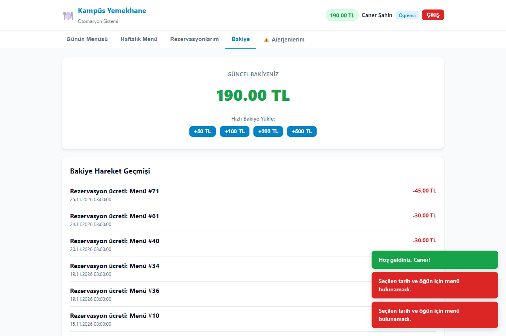

# Yemekhane Otomasyonu - Dönem Ödevi Raporu

- **GitHub Deposu:** https://github.com/Baris12303/webdonemodevi
- **Seçilen Mimari Yol:** Web API + Arayüz (Python FastAPI + HTML5 / CSS3 / Vanilla JS)

Bu ödevde iki mimari yoldan **Web API + Arayüz** yaklaşımını seçtim. Sunucu tarafında FastAPI kullanarak sadece JSON dönen bir API yazdım; arayüz tarafında ise React veya Vue gibi hazır bir kütüphane kullanmadan doğrudan HTML5, CSS3 ve Vanilla JavaScript (`fetch`) ile 7 ekranı hazırladım. Apache container'ı (`:8080`) hem statik arayüz dosyalarını sunuyor hem de `/api/` isteklerini arka plandaki `uygulama:8000` servisine yönlendiriyor.

## 1. Aşama 1: Docker Compose ve MySQL Replikasyonu

- `docker compose up -d` çalıştırıldığında `frontend`, `uygulama`, `mysql-primary`, `mysql-replica`, `redis` servisleri `healthy`, `replica-setup` ise `Exited (0)` olarak tamamlanır.
- `SHOW REPLICA STATUS\G` çıktısında `Replica_IO_Running: Yes`, `Replica_SQL_Running: Yes`, `Seconds_Behind_Source: 0`, `Auto_Position: 1` görülür.
- Kaynakta `CALL sp_bakiye_yukle(6, 100.00)` çalıştırıldıktan sonra replikada `SELECT id, ad, bakiye FROM kullanicilar WHERE id = 6;` ile `290.00` değeri okundu.
- Replikaya yazma denemesi (`UPDATE kullanicilar SET bakiye = 9999 WHERE id = 6;`) `--super-read-only` nedeniyle `ERROR 1290 (HY000)` hatasıyla engellendi.
- `docker stop yemekhane-mysql-replica` ile replika durdurulup kaynakta `CALL sp_bakiye_yukle(6, 50.00)` çalıştırıldıktan sonra `docker start yemekhane-mysql-replica` yapıldığında replika farkı otomatik yakaladı (`340.00`).

## 2. Aşama 2: Uygulama Mimarisi ve Stored Procedure Kullanımı

Backend kodu `routers`, `services` ve `dal` katmanlarına ayrılmıştır; route içinde SQL sorgusu bulunmaz. Para ve kontenjan hareketleri doğrudan stored procedure (`sp_rezervasyon_yap`, `sp_rezervasyon_iptal`, `sp_bakiye_yukle`, `sp_turnike_gecis`) çağırır.

### Bir İsteğin Kod İçindeki Yolu (`POST /api/reservations`)

1. **Route (`backend/app/routers/reservations.py`):**
```python
@router.post("", response_model=ReservationCreateResponse)
def create_reservation(req: ReservationCreateRequest, user: dict = Depends(get_current_user)):
    return ReservationService.create_reservation(user["id"], req.menu_id, req.porsiyon)
```
2. **Service (`backend/app/services/reservation_service.py`):**
```python
result = ReservationDAL.make_reservation(kullanici_id, menu_id, porsiyon)
coords = MenuDAL.get_menu_cache_coords(menu_id)
if coords:
    invalidate_menu_cache(coords["yemekhane_id"], str(coords["tarih"]), coords["ogun_id"])
return {"message": "Rezervasyonunuz başarıyla oluşturuldu.", "rezervasyon_id": result["rezervasyon_id"], "guncel_bakiye": result["guncel_bakiye"]}
```
3. **DAL (`backend/app/dal/reservation_dal.py`):**
```python
with get_primary_connection() as conn:
    with conn.cursor() as cursor:
        cursor.execute("CALL sp_rezervasyon_yap(%s, %s, %s);", (kullanici_id, menu_id, porsiyon))
        cursor.execute("SELECT bakiye FROM kullanicilar WHERE id = %s;", (kullanici_id,))
        user_row = cursor.fetchone()
    conn.commit()
    mark_primary_write(conn)
```

### Replikasyon Gecikmesi (Replication Lag) Açıklaması

Menü listeleme ve geçmiş sorguları `get_replica_connection()` ile replikaya gider. Ancak rezervasyon yapma, iptal etme veya bakiye yükleme işlemlerinin hemen ardından kullanıcıya gösterilen güncel bakiye doğrudan kaynak sunucudan (`get_primary_connection()`) okunur. Çünkü MySQL'de replikasyon asenkron çalışır; kaynakta düşen bakiyenin replikaya yansıması kısa bir süre gecikirse kullanıcı ekranda eski bakiyesini görebilir.

## 3. Aşama 3: Redis Önbellek ve Oturum

- **Menü önbelleği (`menu:{yemekhane_id}:{tarih}:{ogun_id}`):** Gün sonuna (`23:59:59`) kadar TTL ile tutulur. İlk istekte `[CACHE MISS]` / `[CACHE SET]`, sonraki isteklerde `[CACHE HIT]` logu oluşur. Menü değiştiğinde anahtar silinir (`exists` -> `0`).
- **Oturum (`oturum:{token}`):** 30 dakika TTL ile tutulur ve her istekte yenilenir. `docker restart yemekhane-uygulama` sonrasında oturum korunur; çıkış yapıldığında silinir.

## 4. Aşama 4: Değişiklik Talebi (`04_degisiklik.sql`)

- `rezervasyonlar` tablosuna `porsiyon ENUM('tam', 'yarim') DEFAULT 'tam'` sütunu eklendi ve `kullanici_alerjenleri` tablosu oluşturuldu. Replikada `SHOW CREATE TABLE` ile doğrulandı.
- Kahvaltıda yarım porsiyon seçilirse `sp_rezervasyon_yap` hata döndürür (`HTTP 400`). Öğle ve akşam öğünlerinde ücret `%60` hesaplanır (`45.00 TL -> 27.00 TL`).
- Kullanıcının seçtiği alerjenler menüdeki yemeklerle eşleştiğinde menü ekranında kırmızı uyarı gösterilir.
- Eski menü kayıtları `docker exec yemekhane-redis redis-cli flushdb` ile temizlendi.

## 5. Ekran Görüntüleri




