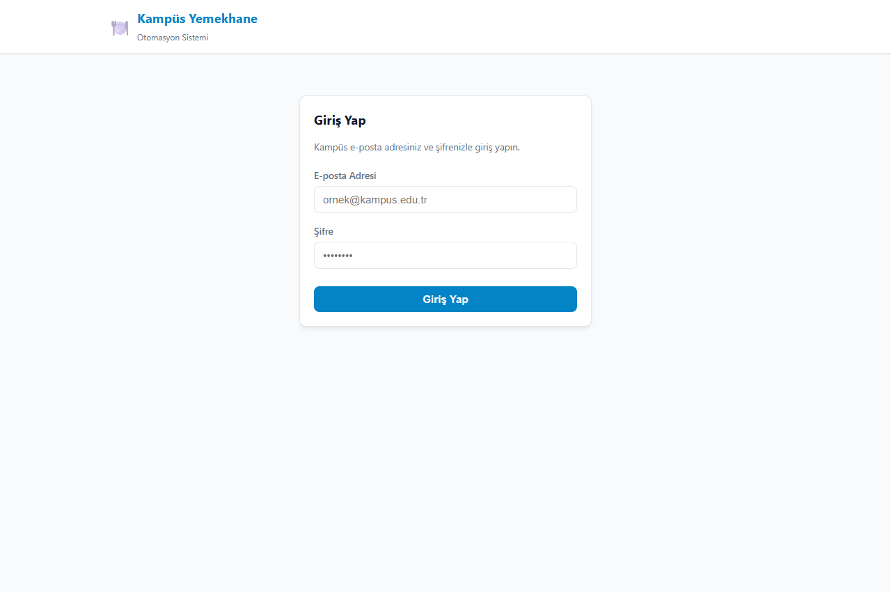
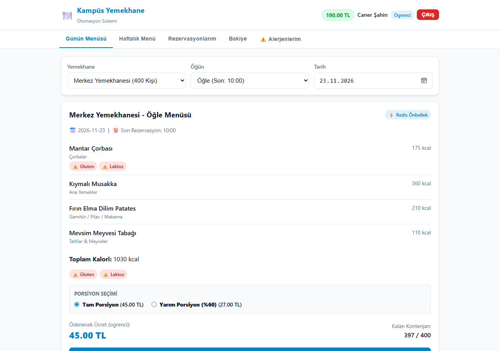
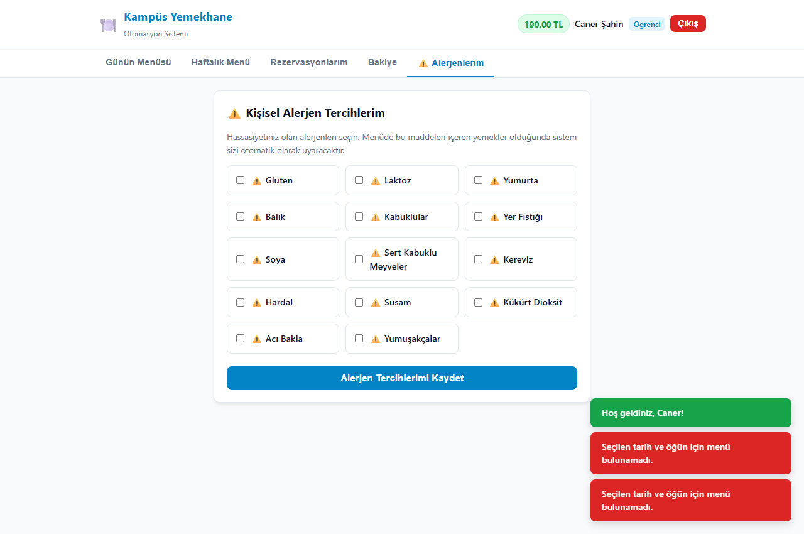
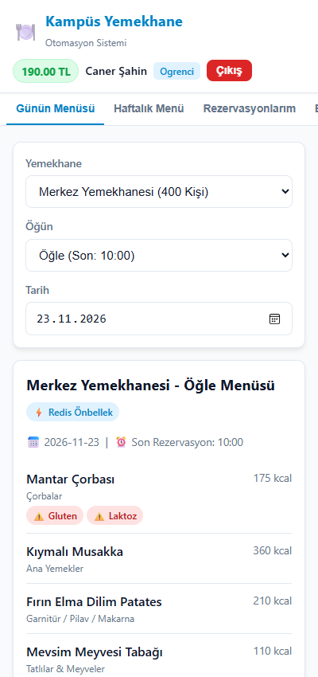

# Kampüs Yemekhane Otomasyon Sistemi — Proje Raporu

* **Ders:** Web Teknolojileri
* **Öğretim Üyesi:** Burak Yılmaz
* **Mimari Seçimi:** **Seçenek B — Web API + Ayrı İstemci** (FastAPI REST API + Saf HTML5/CSS3/Vanilla JS)
* **Altyapı:** Docker Compose (6 Servis: `mysql-primary`, `mysql-replica`, `replica-setup`, `redis`, `uygulama`, `frontend`)

---

## 1. Mimari Seçim ve İstek Akışı

Bu projede **Seçenek B (Web API + Ayrı İstemci)** yaklaşımı seçilmiştir. Sunucu tarafında Python FastAPI ile JSON tabanlı REST API geliştirilmiş; istemci tarafında ise React/Vue gibi çerçeveler kullanılmadan saf HTML5, CSS3 ve Vanilla JS (`fetch`) ile masaüstü ve ~400 px telefon ekranlarına duyarlı arayüz hazırlanmıştır. Tüm HTTP istekleri Apache 2.4 ters vekili (`:8080`) üzerinden karşılanır; `/api/*` istekleri iç ağdaki `uygulama:8000` servisine yönlendirilir.

### Bir İsteğin Uygulama İçindeki Yolu (Örnek: `POST /api/reservations`)
1. **İstemci & Reverse Proxy:** Kullanıcı arayüzde porsiyon seçip rezervasyon butonuna bastığında `app.js`, Bearer token ile `POST /api/reservations` isteği atar; Apache isteği `uygulama:8000` servisine iletir.
2. **Router (`app/routers/reservations.py`):** `get_current_user` Redis üzerinden oturumu doğrular, istek gövdesi `ReservationCreateRequest` ile doğrulanır ve `ReservationService.create_reservation(...)` çağrılır.
3. **Service (`app/services/reservation_service.py`):** `ReservationDAL.make_reservation(...)` çağrısını yürütür; Stored Procedure tarafından fırlatılan `SQLSTATE 45000` hatalarını yakalayıp HTTP `400 Bad Request` yanıtına dönüştürür.
4. **DAL & Veritabanı (`app/dal/reservation_dal.py`):** `get_primary_connection()` ile **Primary** veritabanına bağlanıp `CALL sp_rezervasyon_yap(kullanici_id, menu_id, porsiyon)` prosedürünü çalıştırır.

### Replikasyon Gecikmesi (Replication Lag) Önlemi
Listeleme ve menü sorguları `get_replica_connection()` üzerinden okuma replikasına gider. Ancak **rezervasyon yapma, rezervasyon iptali ve bakiye yükleme** işlemlerinin hemen ardından ekranda gösterilen güncel bakiye değeri doğrudan **Primary** veritabanından (`get_primary_connection()` / `use_primary=True`) okunur. Böylece asenkron replikasyonda milisaniyelik gecikme (replication lag) yaşansa dahi kullanıcının eski bakiyeyi görmesi engellenir.

---

## 2. Aşama 1: Altyapı ve GTID Replikasyonu

* **Replika Durumu:** `SHOW REPLICA STATUS\G` çıktısında `Replica_IO_Running: Yes`, `Replica_SQL_Running: Yes`, `Seconds_Behind_Source: 0`.
* **Salt-Okunur Koruması:** Replika üzerinde `super_read_only = ON` aktiftir; yazma denemesi `ERROR 1290 (HY000)` ile reddedilir.
* **Catch-Up Testi:** Replika durdurulup Primary'de bakiye yüklemesi yapıldıktan sonra replika tekrar başlatıldığında GTID üzerinden eksik transaction'ları otomatik çekip senkronize olmuştur.

---

## 3. Aşama 2: Katmanlı Mimari, Stored Procedure ve Arayüz

* **Stored Procedure'ler:** `sp_rezervasyon_yap`, `sp_rezervasyon_iptal`, `sp_bakiye_yukle`, `sp_turnike_gecis`.
* **SQLSTATE 45000:** Kural ihlallerinde (yetersiz bakiye, süre aşımı, kapasite doluluğu, mükerrer rezervasyon) SP tarafından fırlatılan Türkçe hata mesajları backend'de yakalanıp arayüzde toast bildirimi olarak gösterilir.
* **7 Duyarlı Ekran:** Giriş, Günün Menüsü, Haftalık Menü, Rezervasyonlarım, Bakiye, Değerlendirme ve Yönetici Paneli (~400 px mobil uyumlu).

---

## 4. Aşama 3: Redis Önbellek ve Oturum Yönetimi

* **Menü Önbelleği (`menu:{yemekhane_id}:{tarih}:{ogun_id}`):** Gün sonuna (`23:59:59`) kadar TTL ile saklanır. İlk istekte `CACHE MISS` sonrası DB'den okunup Redis'e yazılır; sonraki isteklerde `CACHE HIT` ile döner. Yönetici menü güncellediğinde veya değerlendirme eklendiğinde ilgili anahtar silinir (`DEL`).
* **Oturum Deposu (`oturum:{token}`):** 30 dakika `Sliding Expiration` TTL ile saklanır. `docker restart yemekhane-uygulama` sonrasında dahi oturum kesintisiz devam eder; çıkış (`logout`) yapıldığında anahtar silinir.

---

## 5. Aşama 4: Değişiklik Talebi (`04_degisiklik.sql`)

* **Yarım Porsiyon (%60):** `rezervasyonlar` tablosuna `porsiyon ENUM('tam', 'yarim') DEFAULT 'tam'` sütunu eklenmiştir. Kahvaltıda yarım porsiyon talebi SP tarafından `SIGNAL SQLSTATE '45000'` (`Kahvaltıda yarım porsiyon seçeneği bulunmamaktadır.`) ile reddedilir. Öğle/akşam menülerinde ücret %60 olarak hesaplanır (`45.00 TL -> 27.00 TL`).
* **Alerjen Uyarısı:** `kullanici_alerjenleri` tablosu ve `/api/auth/allergens` uç noktaları eklenmiştir. Kullanıcının seçtiği alerjenler menüdeki yemeklerle eşleştiğinde Günün Menüsü ekranında uyarı kutusu gösterilir.
* **Eski Cache Temizliği:** Güncelleme sonrası `redis-cli flushdb` ile eski şemaya ait önbellek kayıtları temizlenmiştir.

---

## 6. Ekran Görüntüleri

